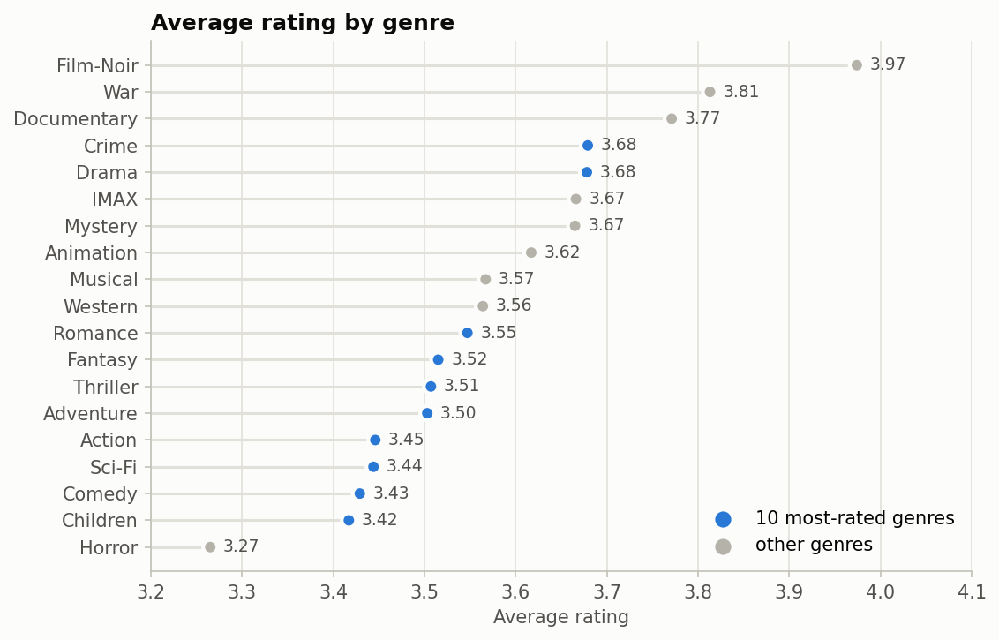

# Movie Ratings: SQL Analysis and Recommender

Exploratory analysis of 500,000 MovieLens ratings with SQL, and a movie recommender compared against a popularity baseline.

## 1. Exploratory analysis with SQL

[`notebooks/01_movie_analysis.ipynb`](notebooks/01_movie_analysis.ipynb) queries a SQLite database with a random sample of 500,000 ratings from MovieLens 20M: 106,761 users and 13,152 rated movies, 1995–2015. The queries use joins, `GROUP BY … HAVING`, and a recursive CTE that splits the pipe-separated genre list.

- **4.0 is the most common rating** (28%). Half-star ratings appear only from February 2003, when MovieLens introduced them.
- **Among the 10 most-rated genres, Crime and Drama rate highest (3.68).** Horror is the lowest-rated genre overall (3.27). Niche genres rate higher still (Film-Noir 3.97, War 3.81), a selection effect: people who seek out niche films tend to like them.
- **The Shawshank Redemption** leads the films with at least 1,000 ratings (4.50 from 1,599 ratings).
- **Older films rate higher** (1950s: 3.88, 2010s: 3.56), most likely survivorship bias: the old films people still watch are the classics.



## 2. Recommender

[`notebooks/02_recommender.ipynb`](notebooks/02_recommender.ipynb), models in [`recsys.py`](recsys.py):

- **Popularity** baseline: the most-rated movies the user has not seen.
- **Item-kNN**: item-based collaborative filtering (cosine similarity with shrinkage).
- **EASE**: a closed-form linear item-item model ([Steck, 2019](https://arxiv.org/abs/1905.03375)).

Evaluation is time-based: each user's most recent 20% of ratings are the test set, hyperparameters are tuned on a validation split made the same way, and the metrics are Precision@10, Recall@10, NDCG@10 and catalog coverage.

The 500K sample above cannot evaluate a recommender. It was drawn rating by rating, so each user kept about 2.5% of their history (median: 3 ratings), and every model, popularity included, scores below 0.2% Precision@10. The recommender therefore uses [MovieLens latest-small](https://grouplens.org/datasets/movielens/latest/), which keeps complete histories for 610 users. The notebook downloads it on first run.

## Run it

```bash
pip install -r requirements.txt
python build_db.py        # needs MovieLens 20M in data/, see below
jupyter notebook notebooks/
```

**Data.** The GroupLens license does not allow redistributing MovieLens, so the data is not in this repository. Download [MovieLens 20M](https://grouplens.org/datasets/movielens/20m/) (or the Kaggle copy, `grouplens/movielens-20m-dataset`) into `data/`; `build_db.py` samples 500,000 ratings into `data/movies.db`. The recommender notebook downloads MovieLens latest-small by itself.

> F. Maxwell Harper and Joseph A. Konstan. 2015. The MovieLens Datasets: History and Context. ACM Transactions on Interactive Intelligent Systems 5, 4: 19. https://doi.org/10.1145/2827872

## Tech stack

Python · SQL (SQLite) · pandas · NumPy · SciPy (sparse matrices) · matplotlib · Jupyter
